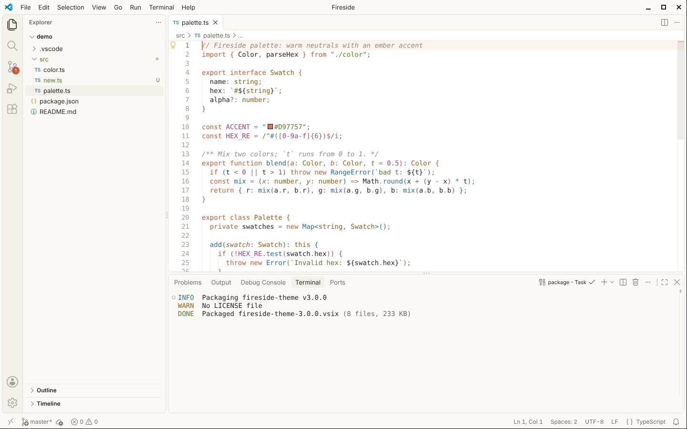
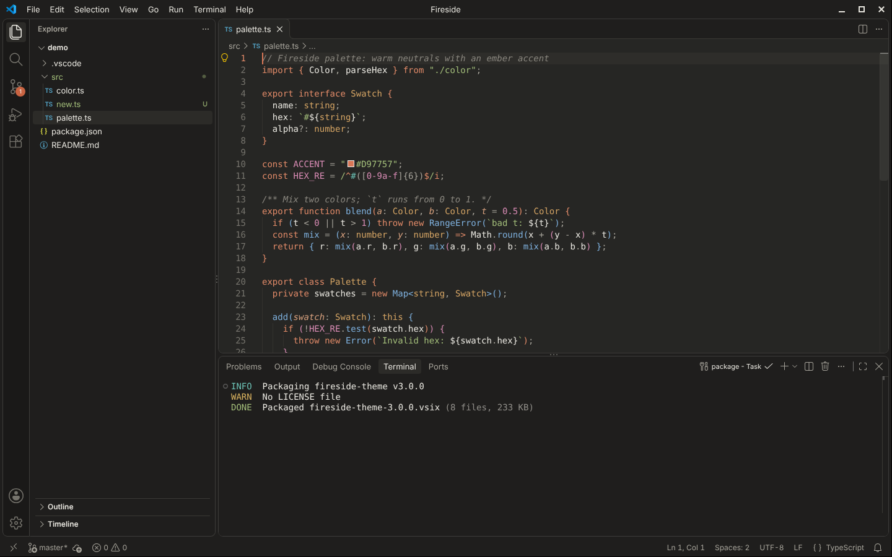

  

<h1 align="center">Fireside Theme for VS Code</h1>

Cosy light and dark themes for Visual Studio Code: warm neutrals, ember orange accents and calm syntax colors.

## Fireside

A white editor with warm ivory sidebars and panels.

## Fireside Dark

A warm charcoal editor with the same ember accents.

## Installation

1. Open the Extensions view in VS Code.
2. Search for "Fireside Theme".
3. Click **Install**.
4. Open **File › Preferences › Theme › Color Theme** and pick **Fireside** or **Fireside Dark**.

## Palette

| Role | Fireside | Fireside Dark |
|---|---|---|
| Editor | `#FFFFFF` | `#262624` |
| Sidebar and panels | `#FAF9F5` | `#1F1E1D` |
| Accent | `#D97757` | `#D97757` |
| Keywords | `#C15F3C` | `#E08A68` |
| Functions | `#2D6A9F` | `#7EB0DD` |
| Strings | `#577A2F` | `#A3BE7A` |
| Types | `#8B5E1A` | `#D4A464` |
| Numbers and constants | `#A0457A` | `#D88BB4` |

## Releasing

Every pull request builds the `.vsix` package in GitHub Actions.

Every merge to `master` releases automatically:

1. The version in `package.json` is bumped based on the merged commit messages:
   - `feat!:` or `BREAKING CHANGE` → major (3.0.0 → 4.0.0)
   - `feat:` → minor (3.0.0 → 3.1.0)
   - anything else → patch (3.0.0 → 3.0.1)
2. The bump is committed to `master` and tagged `vX.Y.Z`.
3. The extension is published to the VS Code Marketplace, and a GitHub release is created with the `.vsix` attached.
